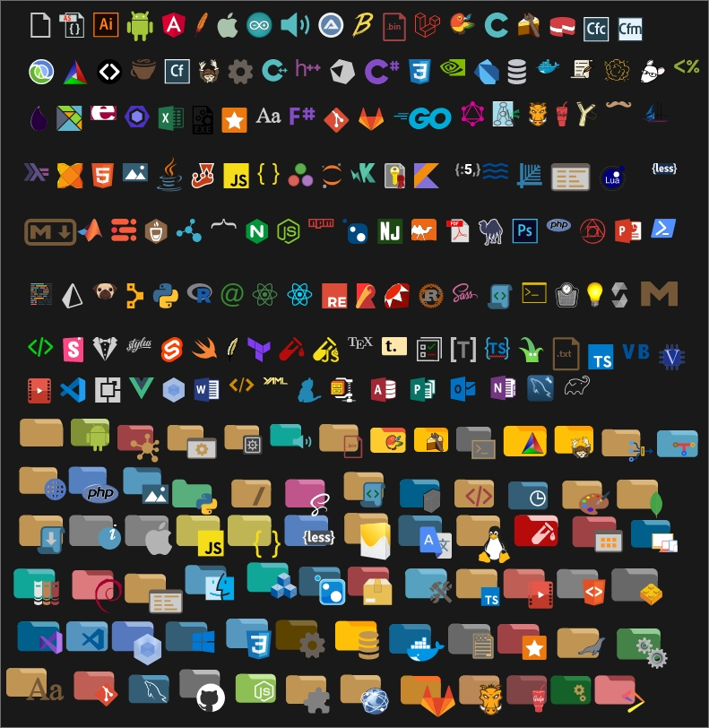
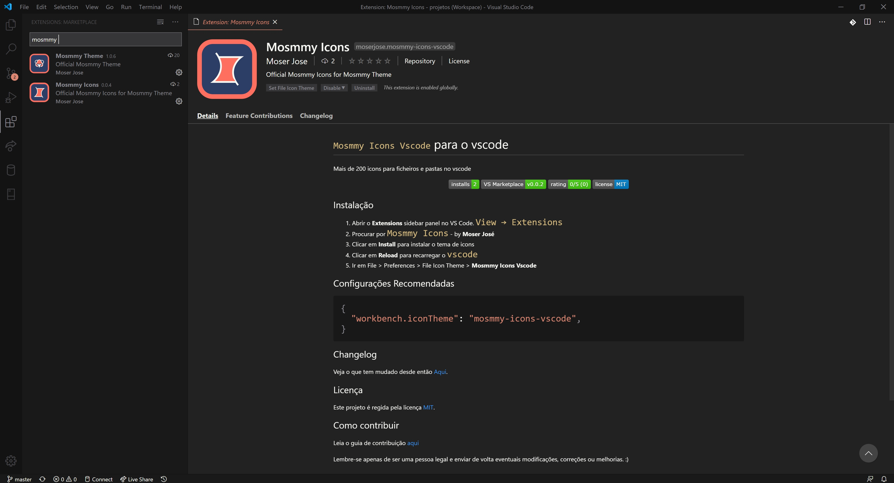

# `Mosmmy Icons Vscode`

Mais de 1.100 ícones para ficheiros e 380 para pastas no vscode

 <div align="center">

[](https://marketplace.visualstudio.com/items?itemName=moserjose.mosmmy-icons-vscode)
[](https://marketplace.visualstudio.com/items?itemName=moserjose.mosmmy-icons-vscode)
[](https://marketplace.visualstudio.com/items?itemName=moserjose.mosmmy-icons-vscode&ssr=false#review-details)
[](https://opensource.org/licenses/MIT)






</div>

## Instalação

1. Abrir o **Extensions** sidebar panel no VS Code. `View → Extensions`
2. Procurar por `Mosmmy Icons` - by **Moser José**
3. Clicar em **Install** para instalar o tema de icons
4. Clicar em **Reload** para recarregar o `vscode`
5. Ir em File > Preferences > File Icon Theme > **Mosmmy Icons Vscode**

## Configurações Recomendadas

```js
{
  "workbench.iconTheme": "mosmmy-icons-vscode",
}
```
## Changelog

Veja o que tem mudado desde então [Aqui](/CHANGELOG.md).

## Licença

Este projeto é regido pela licença [MIT](/LICENSE.md).


## Como contribuir

Leia o guia de contribuição [aqui](/CONTRIBUTING.md)

Lembre-se apenas de ser uma pessoa legal e enviar de volta eventuais modificações, correções ou melhorias. :)

## Autor

| [<br><sub>@moser-jose</sub>](https://github.com/moser-jose) |
| :---: |
